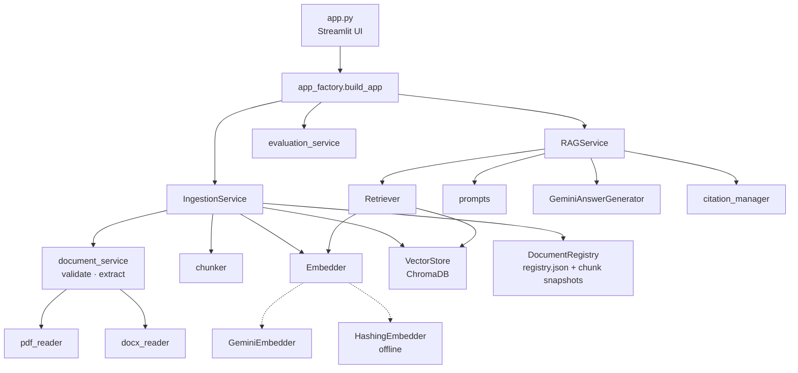

# Architecture

DocuMind is a modular monolith: one Streamlit process, one persistent ChromaDB directory, and small Python
modules with typed interfaces. There are no agents, chains or frameworks between the code and the model.

## Components

| Module | Responsibility |
|---|---|
| `config.py` | Loads settings from env / `.env` (and Streamlit secrets via `app.py`); validates ranges; hides the key from `repr`. |
| `document_processing/pdf_reader.py` | PyMuPDF `get_text("blocks", sort=True)` per page → paragraph blocks with exact 1-based page numbers; flags scanned PDFs (< 40 chars/page). |
| `document_processing/docx_reader.py` | Walks the body in order (`iter_inner_content`) so tables stay in position; headings become `section_heading`; every non-empty paragraph gets a 1-based `paragraph_index`; tables get `table_index`. Never assigns page numbers. |
| `document_processing/cleaner.py` | NFC normalisation (keeps Vietnamese diacritics composed), ligatures, soft hyphens, control and zero-width characters, hyphenated line breaks, whitespace. |
| `document_processing/chunker.py` | Groups blocks into citation units (one PDF page or one DOCX section), packs paragraphs up to `chunk_size`, splits long paragraphs at sentence/word boundaries, carries `chunk_overlap` characters forward inside a unit, keeps tables apart from prose. IDs are `doc_<hash16>:<index>`. |
| `embeddings/` | `Embedder` ABC with a `key` = `provider:model:dimension`. `GeminiEmbedder` batches requests, uses `RETRIEVAL_DOCUMENT` / `RETRIEVAL_QUERY` task types, retries 408/429/5xx with bounded backoff, checks the dimension and L2-normalises. `HashingEmbedder` is a deterministic offline baseline. |
| `retrieval/vector_store.py` | One Chroma collection per embedding key, `hnsw:space=cosine`, `embedding_function=None` (explicit vectors only). Collection metadata records the key and dimension and is verified on open. |
| `retrieval/retriever.py` | Embeds the query, searches with a `document_id $in [...]` filter, then re-checks scope, applies `min_similarity`, removes duplicate passages and enforces a context-size budget. |
| `llm/prompts.py` | System instruction (grounding, citation format, abstention, conflict handling, language, injection rules) and the user prompt that fences each passage in `<source id="S#" document=… location=…>`. Tag-like text inside documents is escaped. |
| `llm/base.py` | `AnswerGenerator` protocol (`generate`, `check`, `provider`, `label`), `GeneratedAnswer`, conversation-history preparation (last 4 turns, citation markers stripped). |
| `llm/openai_compat.py`, `llm/anthropic_compat.py` | ShopAIKey adapters on the official `openai` / `anthropic` SDKs; see [PROVIDERS.md](PROVIDERS.md). |
| `llm/shopaikey.py` | Gateway URL validation, per-protocol base URLs, model catalog, adapter factory. |
| `llm/structured.py` | Lenient JSON answer parsing (bare, fenced, embedded) for providers without enforced JSON output. |
| `llm/gemini_client.py` | Gemini direct and ShopAIKey Gemini-compatible: `generate_content` with `response_mime_type="application/json"` and a Pydantic `response_schema` (`answer`, `insufficient_evidence`), token-usage capture, error mapping. |
| `citations/citation_manager.py` | Assigns `S1..Sn` in rank order; parses `[S1]`, `[S1, S3]`, `[s2]`, `【S1】`; keeps known IDs, strips unknown ones and reports them. |
| `services/ingestion_service.py` | validate → duplicate check → extract → OCR check → chunk → embed in batches → upsert → snapshot → registry. A failed embedding removes any partial vectors. Also delete and re-index. |
| `services/rag_service.py` | Question validation, language detection, no-documents / no-results / retrieval-only / generated / error modes, citation validation and warnings. |
| `services/evaluation_service.py` | Labelled-set evaluation (see [EVALUATION.md](EVALUATION.md)). |

## Providers

Answer generation and embeddings are independent. The vector store and retriever are built once per
knowledge base from server configuration. Each browser session attaches its own generator
(`app_factory.with_generator`), so switching provider, protocol or model never touches the index.
Details: [PROVIDERS.md](PROVIDERS.md).

## Data model and identifiers

- **Document ID** = `doc_` + first 16 hex chars of the file's SHA-256. Identical bytes → identical ID, which
  is how duplicates are detected regardless of filename.
- **Chunk ID** = `<document_id>:<chunk_index:04d>`; upserts are idempotent.
- **Chunk metadata** stored in Chroma: `document_id, filename, file_hash, file_type, chunk_index,
  page_number | section_heading, paragraph_index, paragraph_end, table_index`.
- **Registry** (`<persist_dir>/registry.json`) holds document status (`indexed`, `needs_ocr`, `failed`),
  counts, warnings and the embedding key the vectors were built with. **Chunk snapshots**
  (`<persist_dir>/chunks/<id>.json`) allow re-embedding after a model change without the original file,
  which is never stored.

## Request flow

1. `RAGService.ask` normalises the question (max 2,000 chars) and detects EN/VI.
2. No selected documents → explicit message; nothing is searched.
3. `Retriever.retrieve` embeds the query and searches only the selected IDs.
4. Nothing retrieved → canonical insufficient-evidence message in the question's language; the LLM is not called.
5. No generator configured → *retrieval-only* answer showing the passages.
6. Otherwise the passages are labelled `S1..Sn`, Gemini returns JSON, and citations are validated.
   Unknown IDs are removed (with a warning); an answer with no valid citation is flagged as unverified.

## Why these choices

- **No orchestration framework.** The pipeline is ~1,000 lines of readable code; each stage has unit tests
  and can be explained line by line.
- **Location-bounded chunks.** Letting a chunk span two pages would make "Page N" ambiguous. Short pages
  produce small chunks; that is the price of exact citations.
- **App-controlled citation IDs.** The model never sees filenames as citation keys, so it cannot invent a
  plausible document reference; it can only point at IDs the app issued.
- **Structured output.** A boolean abstention flag is more reliable to act on than parsing prose.
- **Versioned collections.** Mixing vectors from two models silently returns garbage; separating them by key
  makes the failure explicit and recoverable (re-index).

## UI layer (`src/documind/ui/`)

The Streamlit UI only calls the services above; it holds no retrieval or generation logic.

| Module | Responsibility |
|---|---|
| `app.py` | Page config, theme injection, `st.navigation(position="hidden")` with five `st.Page`s, sidebar, run page |
| `ui/session.py` | Settings and app construction (shared cache for the server key; per-session app for a pasted key), durable session state, document-scope sync, conversations, verified model status |
| `ui/theme.py` | Design tokens and a small CSS layer for `dm-*` classes and keyed containers. Neutral tones derive from `currentColor`, so one stylesheet serves both themes |
| `ui/sidebar.py` | Wordmark, New chat, page links, recent conversations, model status, Settings/About |
| `ui/chat.py` | Welcome state, scope-aware suggestions, message rendering, scope chips + composer in `st.bottom` |
| `ui/citations.py` | Answer Markdown (citation markers → numbered badges, `$` escaped), escaped evidence blocks, Sources expander |
| `ui/documents.py` | Upload and indexing progress, document list, inspect and delete dialogs |
| `ui/evaluation.py`, `ui/settings.py` | Benchmark runner and report; settings and About |

Rules for this layer (no hashed Streamlit classes, escape all document text, separate widget keys from
durable state) are in `.claude/skills/minimalist-chat-ui/SKILL.md`.
