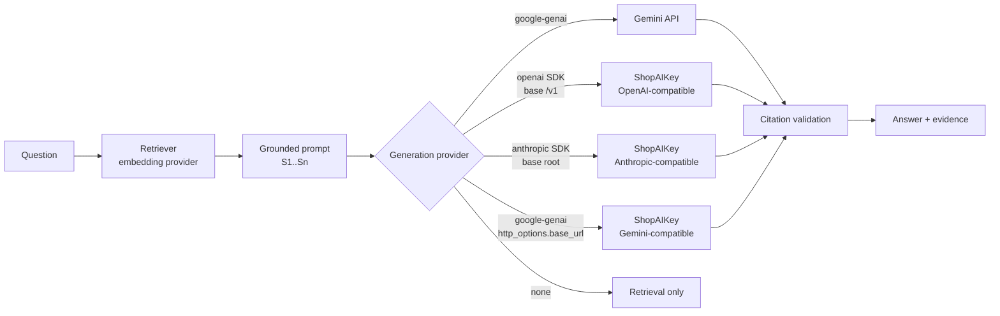

# AI providers

DocuMind separates two jobs:

| Job | Setting | Options | Who can change it |
|---|---|---|---|
| **Answer generation** | `DOCUMIND_LLM_PROVIDER` | Google Gemini, ShopAIKey (3 protocols), Offline | Server default; each user can switch in **Settings** |
| **Embeddings** (search) | `DOCUMIND_EMBEDDING_PROVIDER` | Gemini, ShopAIKey (OpenAI format), Offline lexical | Server only, because changing it requires re-indexing |

Any generator works with any embedder: retrieval, the grounded prompt and citation validation are the same
for every provider.



## Google Gemini (direct)

`GEMINI_API_KEY`, `GEMINI_MODEL`. The connection test uses the free `models.get` endpoint.

## ShopAIKey gateway

[ShopAIKey](https://shopaikey.com/docs/quickstart) is a third-party gateway that exposes many models
behind OpenAI-, Anthropic- and Gemini-format APIs, billed against per-key credit. It is **not** affiliated
with Google, OpenAI or Anthropic.

| `SHOPAIKEY_PROTOCOL` | SDK | Base URL used | Request | Model catalog |
|---|---|---|---|---|
| `openai` | `openai` | `https://api.shopaikey.com/v1` | `chat.completions.create` | `GET /v1/models` |
| `anthropic` | `anthropic` | `https://api.shopaikey.com` (no `/v1`) | `messages.create` | none documented; Claude IDs from `GET /v1/models` |
| `gemini` | `google-genai` | `https://api.shopaikey.com` via `http_options.base_url` | `models.generate_content` | `GET /v1beta/models` |

Sources: [quickstart](https://shopaikey.com/docs/quickstart), [OpenAI format](https://shopaikey.com/docs/openai-format),
[Anthropic format](https://shopaikey.com/docs/anthropic-format), [Google GenAI](https://shopaikey.com/docs/google-genai),
[troubleshooting](https://shopaikey.com/docs/troubleshooting).

### Setup

```env
DOCUMIND_LLM_PROVIDER=shopaikey
SHOPAIKEY_API_KEY=sk-...
SHOPAIKEY_PROTOCOL=openai
SHOPAIKEY_MODEL=<exact model id>
```

Or, without editing `.env`: **Settings → Answer generation → ShopAIKey**, choose the protocol, paste a key
for the session, click **Load models** (or type a model ID), then **Test connection**.

### Model access

Each ShopAIKey key belongs to a *model group*. The catalog lists the gateway's models, not the models your
key may use. A model outside the key's group fails with `No available channel for model … under group …`,
which DocuMind reports as **Model unavailable**. The status only becomes **Connected** after a real request
succeeds: **Test connection** sends one prompt capped at 16 output tokens.

### Connection states

| State | Typical cause (from the ShopAIKey troubleshooting guide) |
|---|---|
| Not configured | No key or no model selected |
| Ready to test | Configured, nothing sent yet |
| Connected | A real request succeeded |
| Authentication failed | 401 `Invalid token`, disabled key, or key sent to the wrong base URL |
| Insufficient balance | 403 `token quota is not enough` / `quota is exhausted` |
| Model unavailable | 404/503 `No available channel`, wrong model ID, model not in the key's group |
| Rate limited | 429 `upstream is overloaded` |
| Service unavailable | 5xx (the guide says failed requests are not charged) |

### Protocol details handled by the adapters

- **OpenAI-compatible:** JSON output is requested in the prompt, not through `response_format`, because not
  every model behind the gateway accepts it. If a model rejects `max_tokens` (newer reasoning models expect
  `max_completion_tokens`) or `temperature`, the adapter adjusts the parameter and retries once.
- **Anthropic-compatible:** the system prompt goes in `system`, text blocks are joined, and usage is read
  from `input_tokens`/`output_tokens`. A base URL ending in `/v1` is rejected, because the SDK adds
  `/v1/messages` itself.
- **Gemini-compatible:** the same adapter as direct Gemini (structured JSON schema), pointed at the gateway.
  The key goes only to the gateway host.

## Embeddings through ShopAIKey (optional)

The OpenAI-format `POST /v1/embeddings` endpoint is documented. DocuMind supports it, but it is **off by
default** and was not verified against a live key during development.

```env
DOCUMIND_EMBEDDING_PROVIDER=shopaikey
DOCUMIND_EMBEDDING_MODEL=<embedding model id>
DOCUMIND_EMBEDDING_DIMENSION=<its output size, e.g. 1536>
```

The vector space key becomes `shopaikey:<model>:<dimension>`, so these vectors are stored in their own
collection and never compared with Gemini or lexical vectors. Every returned vector is checked against the
configured dimension, and a mismatch stops indexing with an explicit message. Existing documents show
**Needs re-index** until you re-index them. If the key or model is missing, DocuMind falls back to the
offline lexical index and says so in Settings and on the Documents page. The fallback is never silent.

## Cost and safety limits

- `DOCUMIND_MAX_OUTPUT_TOKENS` (default 1024) caps every answer. `DOCUMIND_REQUEST_TIMEOUT_S` (default 60).
- Retries: at most `DOCUMIND_MAX_RETRIES` (default 2), only for 429, 5xx, timeouts and connection errors.
  SDK-internal retries are disabled, so the total is bounded. Balance, authentication and model-access
  errors are never retried.
- One chat submission produces at most one request. Reruns are de-duplicated, and the composer is disabled
  while a request runs.
- The model catalog is fetched only when you click **Load models**.
- Token usage is shown under each answer when the provider reports it. No prices are estimated.
- Automated tests never call a paid API. `tests/test_live_shopaikey.py` (marker `live`, skipped without a key)
  makes exactly two short requests.

## Key handling

- Server keys come from `.env` or Streamlit secrets and are never shown in the UI.
- A key pasted in Settings is kept only in that browser session's server-side state. The form is cleared
  after submission, and the key is never written to disk, logs, URLs, browser storage, the process-wide
  cache or exports. **Forget key** removes it.
- The ShopAIKey key is only sent to the configured gateway. `SHOPAIKEY_BASE_URL` must be HTTPS and may not
  point at `api.openai.com`, `api.anthropic.com` or `*.googleapis.com`. Gemini-direct and ShopAIKey keys are
  never swapped.
- Error messages are redacted (`sk-…`, `AIza…`, `Bearer …`, `?key=…`, `x-api-key`).
